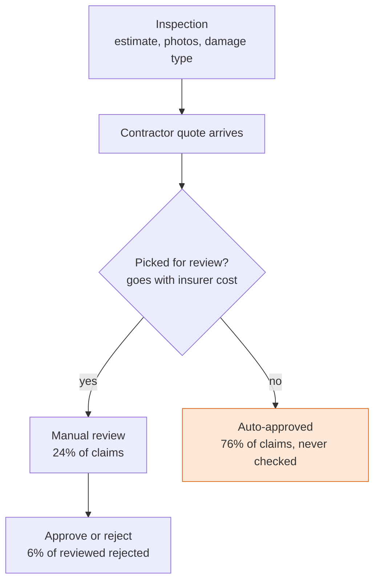
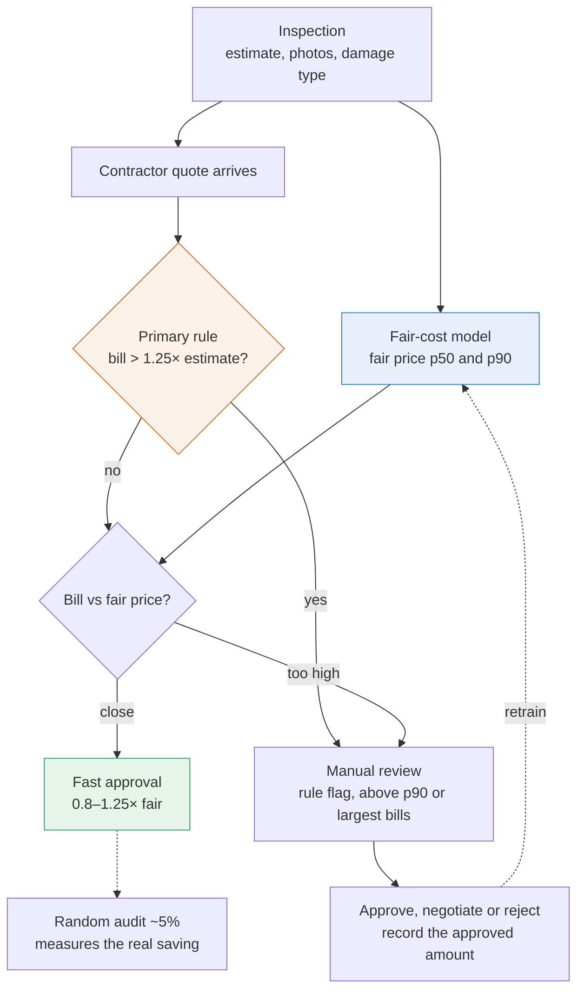

# Claims cost triage: which quotes to review

## Business problem → data science problem
Only ~23% of quotes are manually reviewed. With a fixed number of reviews, the goal is to order the queue
so the reviews catch as much unnecessary cost as possible: a **ranking problem under a capacity constraint**,
measured in euro rather than accuracy. Concretely, score every incoming contractor quote by *expected
rejected value* and route the top of the ranking to a reviewer, auto-approving the rest.

A transparent rule first, two models on top:

| Layer | Question | Data | Method |
|---|---|---|---|
| **Primary – rule** | Is the bill far above the inspector estimate? | every quote with an estimate | review if bill > 1.25 × estimate (`RULE_K` in `config.py`) |
| **A – Fair-cost model** | What should this repair cost, given what the inspection saw? | one quote per approved claim (final quote preferred) | Quantile gradient boosting (p50 and p90) on log cost |
| **B – Rejection model** | How likely is a reviewer to reject this quote? | manually reviewed quotes only (70 rejections) | L2-regularised logistic regression |

`priority_eur = p_reject × quoted amount` ranks quotes for review. Quotes above the fair-cost p90 are flagged too.
The rule and the models are compared head to head on the same reviewed quotes (`src/triage.py`).

**Today** review is picked by insurer cost, not by the bill (counts per claim):


**Proposed:** the rule catches large overruns, then every other bill is compared with a fair price:


## Setup
Tested with Python 3.12 on macOS. The dataset is included in `data/`, so no download is needed.
```bash
git clone <repo-url> claims_cost_triage
cd claims_cost_triage
```

**Option A: venv + pip**
```bash
python3 -m venv .venv
source .venv/bin/activate          # Windows: .venv\Scripts\activate
python -m pip install --upgrade pip
pip install -r requirements.txt
```

**Option B: conda**
```bash
conda env create -f environment.yml
conda activate claims-cost-triage
```

## Run
With the environment active, from the project folder:
```bash
python run_pipeline.py                            # reads data/tech_data_2026.xlsx, writes outputs/
python run_pipeline.py path/to/tech_data_2026.xlsx
jupyter lab notebooks/01_data_exploration.ipynb   # default "Python 3" kernel
streamlit run app.py                              # demo app, opens in the browser
```
The pipeline takes about a minute. The app trains its models on first load (about a minute) and caches them.
The notebook and the app read `data/tech_data_2026.xlsx` by default; set the `CLAIMS_DATA` environment
variable to use another file.

## Project layout
```
notebooks/01_data_exploration.ipynb   step-by-step EDA with findings (run before the pipeline)
app.py            Streamlit demo: problem, data issues, explorer, hypotheses, model results, quote checker, review queue, verdict
src/config.py     paths, feature lists, rule settings
src/data.py       load, data-quality report, cleaning, collapse to one row per quote / per claim
src/features.py   quote vs estimate features, feature matrix
src/eda.py        figures 01–04 + EDA tables
src/models.py     Model A (fair cost) and Model B (rejection), grouped out-of-fold CV
src/evaluate.py   capture curves, review-budget table, figures 05–07
src/triage.py     primary rule (bill > k × estimate), rule table, head-to-head with the fair-cost model
run_pipeline.py   end-to-end run
data/             tech_data_2026.xlsx (the dataset)
requirements.txt  pip dependencies; environment.yml wraps them for conda
```

## Demo app
`streamlit run app.py` opens a browser app with eight pages:
1. **Problem & approach**: the business → data science framing, today's and the proposed workflow, headline numbers
2. **Data & limitations**: review rate by quote/estimate gap, selection bias, data-quality report
3. **Explore the data**: cost and bill ÷ estimate by feature, feature distributions, inspection orgs, review & decisions
4. **Hypotheses**: H1–H5, whether each holds and where to see the evidence
5. **Model results**: primary rule, secondary models, the head-to-head at an adjustable review budget, unchecked overpricing (audit candidates)
6. **Quote checker**: enter inspection details and a quote, get the fair-cost range, P(reject) and a review/approve recommendation (includes the claim 2 example)
7. **Review queue**: all quotes ranked by the primary rule or by € at risk for a chosen review capacity, compared with today's reviews, downloadable as CSV
8. **Verdict & next steps**: where ML helps and where it doesn't (yet), and approaches to explore with more time

If no data file is found, the app offers an upload button.

## Key modelling decisions
- **Unit = quote.** Rows sharing a quote_id have the same contractor cost, estimate, decision and
  review flag, so they are collapsed to one row. About 12% of quotes have rows with conflicting
  categories (e.g. House vs Commercial for the same building); each category is resolved by majority
  vote (ties -> first row; documented in `data.py`). The fair-cost model uses only the raw
  inspection-time columns (`CATEGORICAL` + `NUMERIC_PRE_QUOTE` in `config.py`).
- **Fair-cost model on one quote per claim.** A claim's quotes are adjusted over time, so they are
  revisions of the same repair. Model A is trained on one quote per claim, cleaned as in
  `notebooks/01_data_exploration.ipynb`: the final quote if there is one, otherwise the latest
  preliminary quote (`to_claim_level` in `data.py`). Every quote is still scored by the fold model
  that did not see its claim, so the rejection model (Model B, all quotes) gets honest fair-cost inputs.
- **Grouped CV by claim_id.** Quotes from the same claim never end up in both train and test.
- **No leakage.** `insurance_company_cost`, `policyholder_cost`, `decision_on_quote` and
  `manual_review` are produced after the decision and are never used as features.
- **Rare inspection orgs** (<10 quotes) are grouped into `OTHER`.
- **Evaluation in €.** Share of rejected € caught at a given review budget, compared with
  the simple rule "review the largest quotes first".

## Results (out-of-fold, from this dataset)
Primary rule vs secondary model on the same 762 reviewed quotes with an estimate (67 rejected):

| Approach | ROC-AUC | Rejected € caught @ 20% budget |
|---|---|---|
| primary: rule, bill ÷ estimate | 0.54 | 33% |
| secondary: fair-cost + P(reject) × bill | 0.68 | 80% |

- **The model beats the rule, mostly by looking at the biggest bills first.** The price gap alone (rule or fair-cost)
  barely predicts rejection. The rule (k = 1.25) still catches 97% of severe overruns (> €20k over the estimate).
- **Fair-cost model (A):** MAE €22k vs €37k for "quote = estimate"; the p90 band holds 83% of bills (target 90%).
- **Auto-processed claims:** 17.5% are above fair p90, about €14M above fair p50: a candidate saving that needs an audit.

Details: `outputs/` (`rule_vs_fair_cost.csv`, `fair_cost_metrics.csv`, `rejection_metrics.csv`, …) and the app's
*Model results* page.

## Limitations
- Rejection labels exist **only** for reviewed quotes, and review targets large claims.
  The rejection model is therefore trained on a biased sample, and its scores on
  auto-processed quotes are extrapolation.
- There is no label for "how much was saved". Rejected/approved is a weak proxy.
- Inspector estimates are bucketed to €10k (240 zeros, 3.5% missing). Building area is 50% missing.
- Costs look capped at €300k. There are no dates, so time drift and time-based validation can't be checked.
- Being overpriced relative to the fair cost does **not** predict rejection in this data
  (negative coefficient). Rejections may be driven by coverage or policy reasons more than price.

## Next steps
1. **Random audit** of ~5% of auto-approved quotes to get unbiased labels. This is the main recommendation.
2. Record the **approved amount after review** so savings can be modelled as a regression target.
3. Add claim/quote dates, quote line items and inspection images (CV model on photos).
4. Use inspection-org level feedback as a lever separate from claim triage.
5. Calibrate p90 (coverage is currently 83%) with conformal prediction. Monitor drift and contractor behaviour after deployment.
